# ui-fix

**The UI fixer that thinks like a senior UI engineer — and proves it.**

Point it at a page, form, table, modal or single component. `ui-fix` works out what the screen is for, walks it as real users, measures everything, fixes it against your `design.md`, proves the fix with before/after numbers and visual regression, and remembers your decisions for next time.

It also fixes what makes UI look **machine-made**: inconsistent margins and padding, everything centred, off-scale spacing, shouting copy, gradients and glows, emoji icons, the same SaaS template for every product. The result is a screen with proper spacing, plain words, easy navigation and a look that belongs to *your* product. For React + Tailwind it builds with [befui](https://github.com/RandomKid24/befui) components, restyled to your brand.

Works with **Claude Code, OpenCode, Antigravity, Codex** — and any tool that reads skills.

The bar: **someone who has never seen your app knows what this screen is, what to click, and what happens next — without thinking. Daily users finish in the fewest steps. Nobody loses work.**

---

## Install

```bash
npx github:RandomKid24/ady-uifix-skill
```

Detects your AI tools and asks where to install. Press Enter for all detected. Restart your tool afterwards.

```bash
npx github:RandomKid24/ady-uifix-skill -y                    # no questions, all detected tools
npx github:RandomKid24/ady-uifix-skill --claude --opencode   # pick tools
npx github:RandomKid24/ady-uifix-skill --project             # this repo only (team gets it via git)
npx github:RandomKid24/ady-uifix-skill --dir <skills-folder> # any other tool
npx github:RandomKid24/ady-uifix-skill --list                # where it goes / what's detected
npx github:RandomKid24/ady-uifix-skill --uninstall           # remove
```

**Update:** run the install again. If npx serves an old copy: `rm -rf ~/.npm/_npx` first.

Needs Node 18+. No dependencies.

| Tool | Global | `--project` |
|---|---|---|
| Claude Code | `~/.claude/skills/ui-fix` | `.claude/skills/ui-fix` |
| OpenCode | `~/.config/opencode/skills/ui-fix` | `.opencode/skills/ui-fix` |
| Antigravity | `~/.gemini/antigravity/skills/ui-fix` | `.agent/skills/ui-fix` |
| Codex CLI | `~/.codex/skills/ui-fix` | `.codex/skills/ui-fix` |

Manual: copy `skills/ui-fix` into your tool's skills folder.

---

## Use

**Claude Code**
```
/ui-fix src/pages/checkout/CheckoutForm.tsx
/ui-fix quick the vendor list
/ui-fix sweep src/pages/settings
/ui-fix handoff the add-invoice form
```

**OpenCode / Antigravity / Codex** — name it in plain words:
```
use ui-fix on src/pages/checkout/CheckoutForm.tsx
use ui-fix sweep on src/pages/settings
```

Or just describe the problem: *"this form is confusing, fix it"*, *"the dashboard looks off"*.

Point it at a file, a folder, a local URL (`http://localhost:5173/checkout`), a screen by name, or a pasted screenshot.

It asks **one question first** when the request is vague: what feels wrong, and how far to go —

| Level | What happens |
|---|---|
| **Fix** | Broken and confusing things only. Your look stays |
| **Polish** | Fix + tidied look within your design system |
| **Redesign** | A new look — 2–3 directions rendered on your real page, the best one applied, one-step undo |

| Mode | What you get |
|---|---|
| `fix` *(default)* | Everything: understand → see → walk → measure → judge → fix → prove → remember |
| `quick` | Full audit + score + report. No code touched |
| `sweep` | Audits every screen in a folder, ranks them, fixes shared root causes first |
| `handoff` | Audit + a paste-ready implementation prompt for another coding agent |

---

## How it works

| Phase | What happens |
|---|---|
| **0. Ask & remember** | Asks one question if the request is vague (Fix / Polish / Redesign, which screen). Reads `.ui-fix/memory.md` (past decisions, rejected ideas, glossary) and your `design.md`. No design.md? Says so and offers to generate one |
| **1. Understand** | Works out what the screen is for, who uses it and how often, what it loads and saves (reads the API and backend), the business rules, the flow, every element's purpose, and the shortest task path. Catches UI ↔ backend mismatches. Shows a short *Screen brief* |
| **2. See** | Runs your dev server, screenshots desktop + mobile and key states |
| **3. Walk** | Tries the task as real users — **Newcomer** and **Keyboard-only** always, plus Power user / Touch / 200% zoom / Regional language / Interrupted when they apply. 5-second test, first-click test, friction log. Then **stress tests**: breakpoints, zoom, pseudo-localization, other scripts (Devanagari, Arabic, CJK, Thai, Cyrillic), right-to-left, long values, 0/1/1000 rows, slow network, errors, dark mode. Compares with sibling screens for consistency |
| **4. Measure** | A designer's visual critique (grid, alignment, balance, rhythm, reading path), then eleven scanners: **slop scan** (off-grid spacing, sibling mismatches, centred text, AI tells), **visual style inventory**, **layout & spacing**, **text density**, **clipped content**, accessibility (axe), hierarchy & naming, dependent fields, keyboard & focus, text stress, design-token drift. Effort table for forms |
| **5. Judge** | Every issue gets severity, an **Impact score** (severity × frequency × reach), a principle tag, evidence, and file:line. Finds the shared root cause and every screen it affects. Scores 0–100 |
| **6. Report** | Blunt and short. Always ends with **design suggestions**: 2–3 visual directions built from **your product's own identity** (brand, personality, users, domain) — genuinely different from each other and from the generic SaaS look — rendered on your real page, with the exact tokens that change and which one it recommends. A **layout blueprint** that says where every component goes, how wide, with what spacing — and why. Hierarchy, rename, dependency, effort, stress and consistency tables |
| **7. Fix** | In a fixed order — **spacing → alignment → words → colour → type → icons → details → motion → one rich moment** — so each pass makes the next one easier. Controls come from your own components first, then **befui** (asks before adding), then your kit. Every 🔴 and 🟠 fixed or the blocker named. Bigger upgrades shown as an "Upgraded" view for you to approve. A screen with no slop is left alone |
| **8. Prove** | Re-scans, re-walks, re-scores. **Visual regression** on every screen using a changed shared component. Checks the save payload and tests still pass. Builds a demo with Before / Fixed / Upgraded / each design direction as tabs — pick a look by seeing it — with a proof panel. Adds a regression test or lint rule. Updates design.md and memory |

### What it catches

- **AI-generated look** (measured by `slop-scan.js`) — spacing off the 4px scale (13px here, 22px there), siblings with different padding or height, text and whole layouts centred by default, an app squeezed into a narrow centred column, violet→blue gradients, gradient text, coloured glows, emoji as icons, UPPERCASE tracked labels, weight-800 headings, "Welcome back 👋", hype words and `!`, unverifiable claims, infinite pulses, `transition: all`, bouncy easing
- **Generic look** — screens that could be any SaaS template (light grey page, white cards, tiny uppercase labels, one blue button, pills, pastel gradient). Every product should look like itself; it starts from your brand and personality and runs an anti-template check
- **Text & content** — too many words on a dashboard (aim ≤ 250), text under 13px, piles of explanation lines, the same number shown twice, content hidden by fixed-height cards and cut-off text
- **Dashboards** — no headline, too many signals, duplicated metrics, details not on demand, charts that don't answer a question
- **Visual design** — too many font sizes/colours/radii/button styles, near-duplicate sizes, brand colour on everything, flat or noisy surfaces, inconsistent components, nothing standing out, dated look, low-contrast text
- **Layout & spacing** — forms stretched 1800px wide, Yes/No buttons floating in empty columns, a full-width dropdown next to a tiny button pair, number fields as wide as a paragraph, zig-zag 2-column grids of unrelated fields, near-miss alignment, random gaps (13px here, 22px there), ragged rows, children placed in the wrong column
- **Hierarchy & naming** — section titles that look like field labels, a section and its field with the same name, near-identical labels, codes like SKU/PO/Qty., vague labels, truncated text, "Select" placeholders, "NA" typed into fields, Yes/No with no visible selection
- **Dependent fields** — clicks every choice to map which fields depend on which; flags children far from their parent or greyed out with no reason; checks reset-on-change and hidden values not being saved
- **Way-finding** — long forms without numbered sections, section index, progress, or icons; catch-all sections like "Other"
- **Forms & data entry** — fields that could be derived, defaulted or deferred; wrong controls (2-option dropdowns, 50-option plain selects); dropdown order and labels; validation and error summary; lost work
- **Keyboard** — tab order vs visual order, invisible focus, clickable divs keyboard users can't reach
- **Stress** — what breaks with long text, other scripts, right-to-left, 200% zoom, lots of data, slow network, errors
- **Accessibility** — real axe numbers ("contrast 2.8:1, needs 4.5:1"), tap targets, overflow
- **Design-system drift** — hardcoded colours, px, Tailwind arbitrary values, inline styles
- **Consistency** — same job, same pattern, same names across screens
- Plus tables, dashboards, modals, navigation, single components, states (loading / empty / error / disabled / success)

### Example report

```
## Checkout form — 48/100
Purpose: Shoppers pay for their cart so the order ships. Occasional use, mostly mobile.

Walkthrough: Newcomer 12 steps · 5 friction · completed ✓ | Keyboard ✗ stuck at Payment method

🔴 [27] 1. Section titles look like labels — 16px/500 vs labels 14px/500 (1.14×). Newcomer
          couldn't tell where Shipping ends and Payment starts. [Proximity] CheckoutForm.tsx:212
🔴 [18] 2. Tab jumps from Country to Pay, skipping Postal code. [A11y] CheckoutForm.tsx:88
🟠 [18] 3. "Card number" sits in the other column and greys out silently. [Proximity][Visibility]
🟡 [4]  4. #1a73e8 ×6 — design.md says --brand-primary.

Root cause: 1 comes from components/form/Section.tsx — also affected: SignupForm, AddressForm.
```

### Score (rubric v3)

Scores are only compared within the same rubric version.

| Category | Points |
|---|---|
| Clarity, hierarchy, naming & way-finding | 20 |
| Layout, spacing & placement | 20 |
| Usability for this kind of UI + text & content | 15 |
| States & feedback | 10 |
| Accessibility & keyboard | 15 |
| Visual design, system & consistency | 10 |
| Responsive & stress | 10 |

🔴 −8 · 🟠 −4 · 🟡 −2 per issue in its category. Always shown before and after.

---

## What you get back

Plain language, in this order:
1. **What you will see differently** — max 5 changes, with where to look
2. **How to see it** — URL, role, refresh or restart, whether anything is committed, and how to undo
3. **What was wrong**
4. **Options to go further** — design directions
5. **Not tested**
6. **Score** (rubric v3)
7. **Details** — the technical evidence
8. **Files changed**

Safe to try: before editing several files it saves a **restore point** (`.ui-fix/runs/<run>/backup-before/` + `restore.sh`), screenshots after **every** change, checks your dev server is really serving it, and re-renders **every role/variant** of a shared screen.

Pages behind login or an API: it builds a reusable **test harness** (Playwright + mocked routes using your own fixtures, matching your real API shapes) in `.ui-fix/harness/`.

Says *"I don't see changes"*? It checks, in order: files changed → server serving them → right URL/role → hard refresh → only local → or just subtle (and offers a bigger option).

## Looks designed, not generated

Most "AI UI" fails in the same ways, and most of them are measurable. `ui-fix` checks them before and after, and fixes **craft first, decoration never**:

| Craft check | What it enforces |
|---|---|
| **Spacing** | One scale (multiples of 4). Same thing, same size — siblings share padding, height and gap. Space shows grouping: inside a group < between groups < between sections |
| **Alignment** | Text, labels, lists and tables are left-aligned; numbers right-aligned; one left edge per column. Apps fill the window — no 640px centred column in a 1440px app. Centre only a short title or an object in free space |
| **Words** | Plain and short: "Save changes", not "Submit". No hype words, no `!`, no greeting headlines, comparisons say what they compare to ("+12% vs last month"), seed data looks real |
| **Hierarchy** | One primary action, one headline value, size and colour before weight, three text roles |
| **Navigation** | Where am I, what's next, how do I get out — obvious to a stranger. Disabled things explain why |
| **Uniqueness** | Quiet chrome, **one rich moment** per screen and **one signature detail** that only this product has. The swap test: put another product's name on it — if it still fits, it's a template |

It also decides **how much to change**: heavy slop → full pass; light slop → only what the scan found; none → *"this is fine"* and at most three small refinements. It never redesigns a good screen just to make it different.

```
slop-scan.js  →  heavy slop — full pass
  gradientText 1 · hueGradient 1 · colouredGlow 3 · emoji 1 · greetingHeadline 1 · hypeWords 1
  uppercaseTrackedLabel 3 · infiniteAnimation 3 · transitionAll 3 · bouncyEasing 1
  craft: offGridSpacing 20 (13px×4, 17px×4, 22px×4…) · siblingPaddingMismatch 1 · narrowCentredColumn 1 · centred text 100%

slop-scan.js  →  little or no slop — leave the look alone, fix craft items only
```

**The previews below follow the same rules** — every screen was run through `slop-scan.js`: spacing on the 4px grid, left-aligned, no gradients, glows or emoji. The only flags are weight-800 headings in Swiss and Industrial, which those styles call for (and the report would say so).

## Components: befui

For **React + Tailwind** projects, `ui-fix` builds controls with **[befui](https://github.com/RandomKid24/befui)** ([docs](https://befui.vercel.app)) — 273 copy-paste components, 38 page blocks, 389 icons and 10 palettes on Radix + Tailwind 4, plus the same components as `<bef-*>` HTML tags and 121 Flutter widgets. You own every file; there's no package to upgrade.

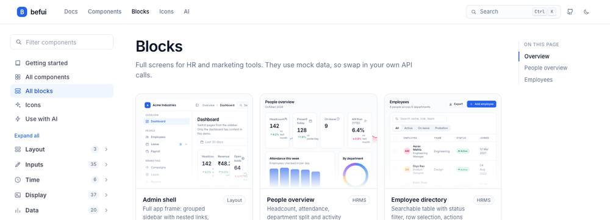

- **Order:** your own components → **befui** → your UI kit. If your project already uses befui it just uses it; if not, it recommends it once and **asks before** running `init`/`add` (those touch `index.css`, `AGENTS.md`, `.mcp.json` and npm packages).
- **Real commands, no guessing:** `npx github:RandomKid24/befui add select combobox`, `list`, `diff`, `update`, and an MCP server (`list_components`, `get_component`, `add_components`). Never retyped from memory, never mixed with another icon set.
- **A job-to-component map** (forms, dependent dropdowns, tables, charts, approvals, settings, auth, AI chat, time…) so it picks `cascader` or `combobox` for the right reason.
- **Not left at the default.** befui's default is quiet slate + blue; ui-fix restyles through its tokens (`--primary`, `--radius`, density, palette, type) so your product keeps its own identity instead of looking like every befui site.
- Fix-level example: a hand-built dropdown with no keyboard support becomes `select`/`combobox`, payload and handlers unchanged; Polish sets the tokens; Redesign builds each direction from different components.

<table>
<tr>
<td width="50%">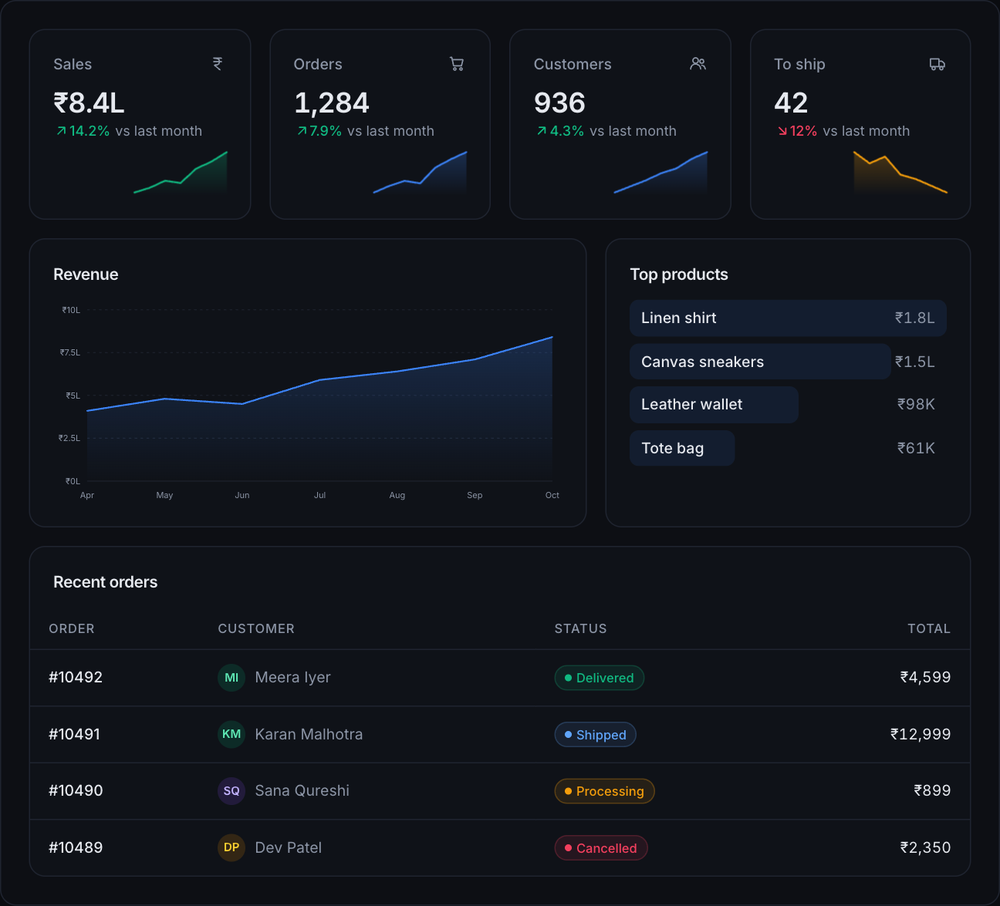</td>
<td width="50%">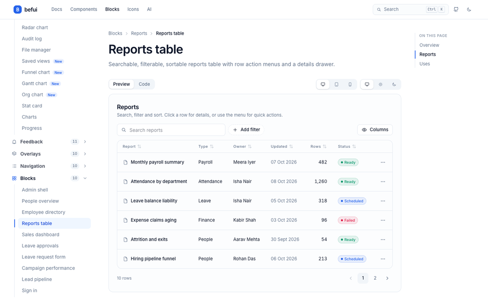</td>
</tr>
</table>

<sub>befui is by the same author, MIT-licensed. Screenshots are from its README. Full guide for agents: <code>skills/ui-fix/references/library/befui.md</code>.</sub>

## Design library

So it doesn't design every product the same way, the skill carries a library a senior designer would have in their head. It picks from it by **your product's identity**, and its 2–3 directions always use different styles or blends.

### 12 visual styles

Each style is shown on a screen from the domain it suits — not the same dashboard re-skinned. Every style comes with fonts, colours, surfaces, shape, density, signature details, when to use and avoid it, plus a **slop trap** (how it turns into a template when used by habit) and **done right**. The skill blends two when it fits (e.g. *Dense pro × Warm hospitality* for a POS).

| | |
|---|---|
| 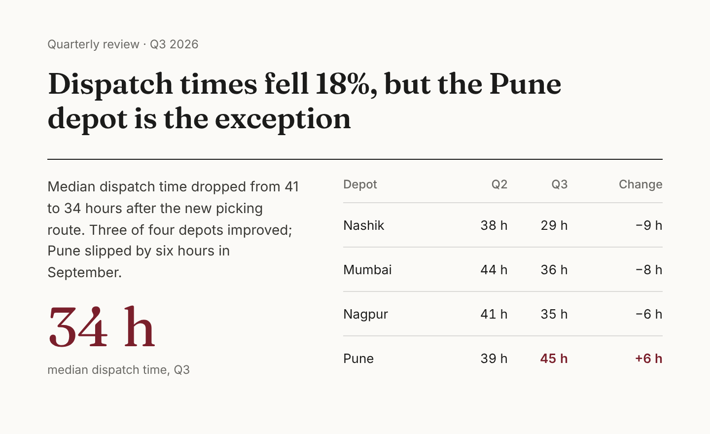 | 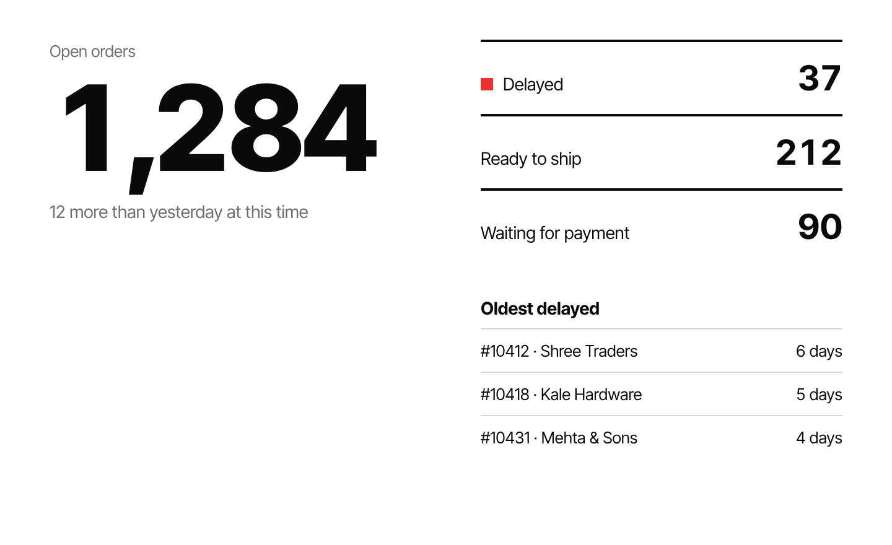 |
| **Editorial** — a quarterly review · reports, knowledge bases, premium B2B | **Swiss functional** — an orders console · admin, analytics |
| 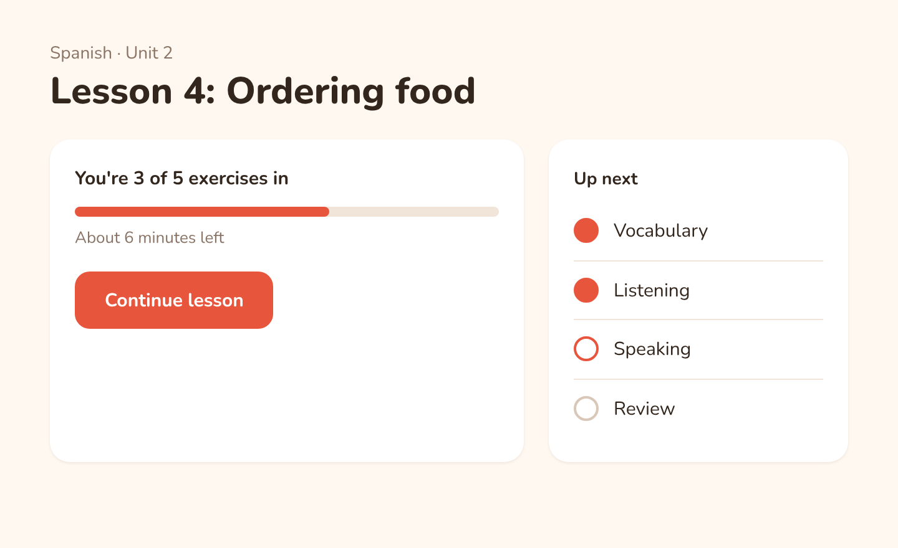 | 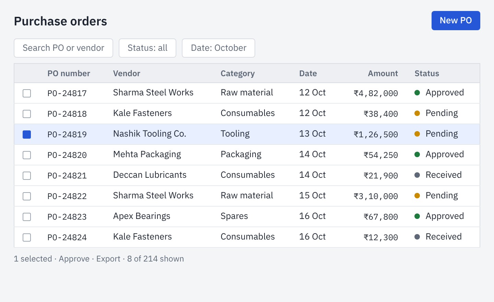 |
| **Soft & friendly** — a lesson · consumer, education, onboarding | **Dense pro** — purchase orders · ERP, accounting, all-day use |
| 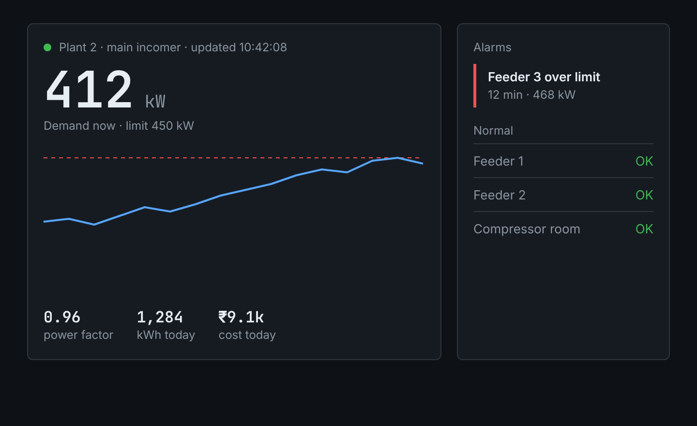 | 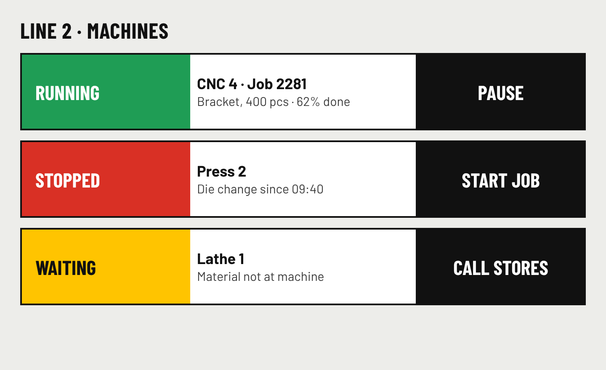 |
| **Dark command center** — an energy meter · monitoring, IoT, control rooms | **Industrial** — a machine board · factory floor, warehouse, tablets |
| 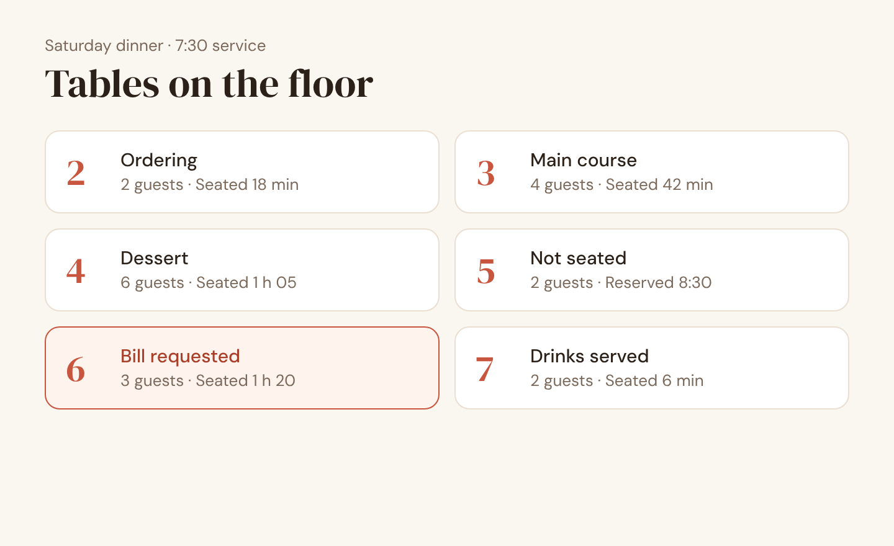 | 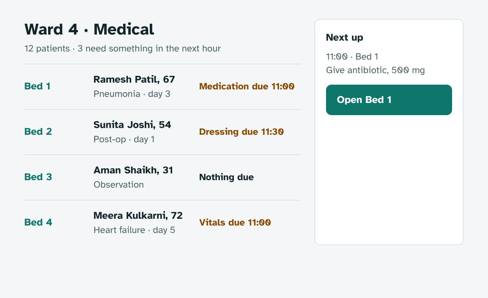 |
| **Warm hospitality** — a restaurant floor · restaurants, salons, hotels | **Clinical calm** — a ward list · healthcare, pharma, labs |
| 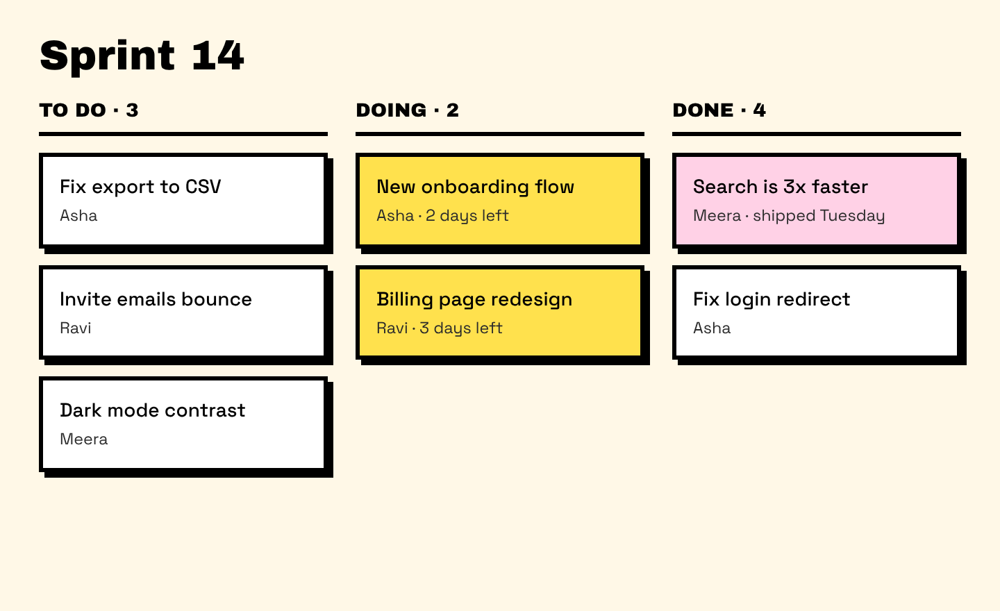 | 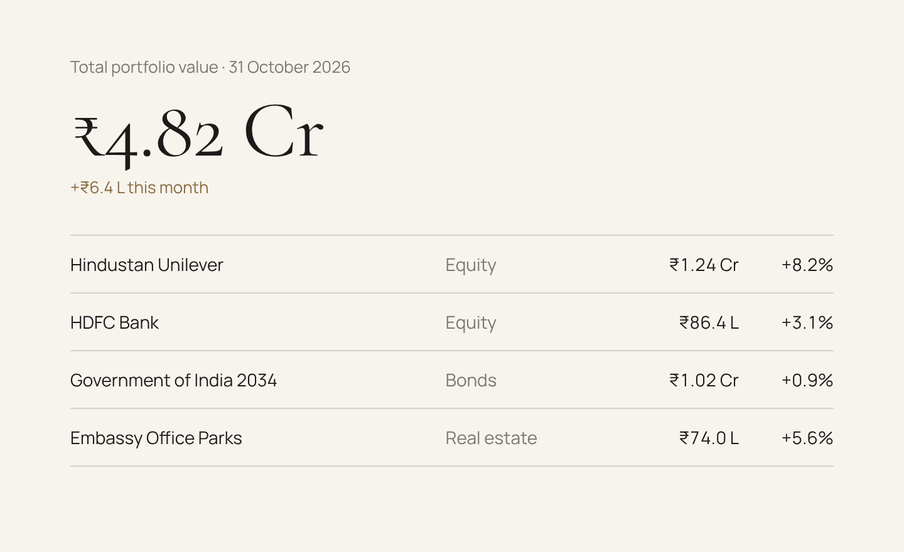 |
| **Neo-brutalist** — a sprint board · startups, creative tools | **Premium minimal** — a private portfolio · wealth, luxury |
| 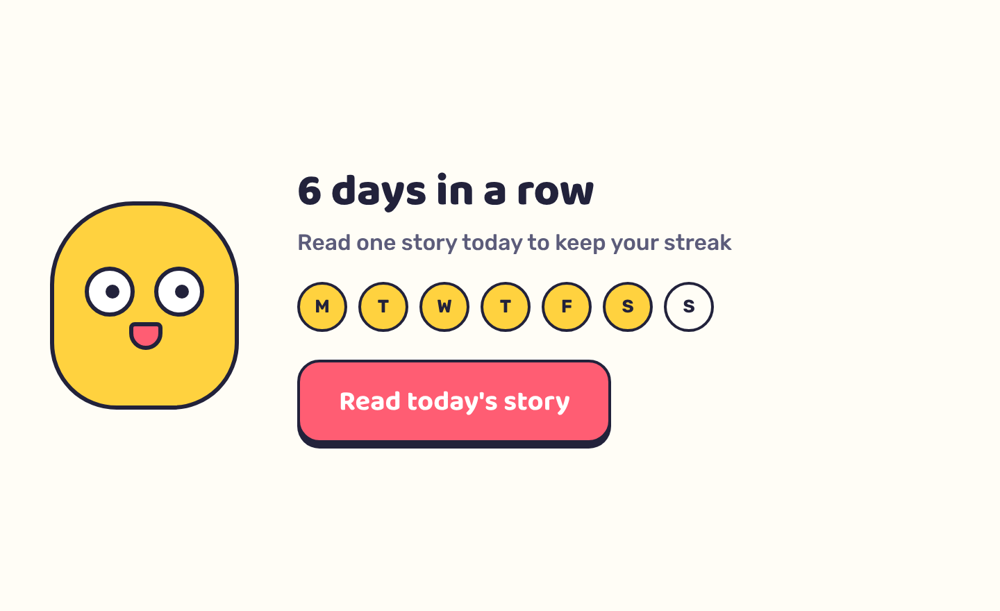 | 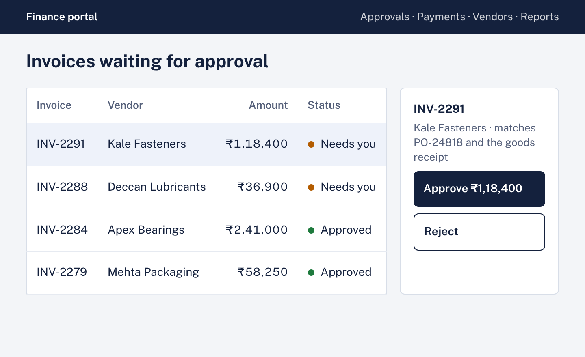 |
| **Playful** — a reading app · engagement, learning, mascots | **Corporate trust** — an approvals queue · banking, insurance, enterprise |

### Layout patterns

Different directions can use different **layouts**, not just different colours.

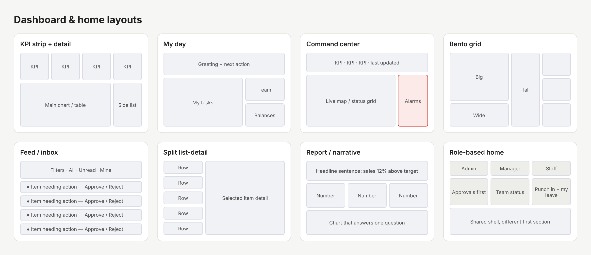

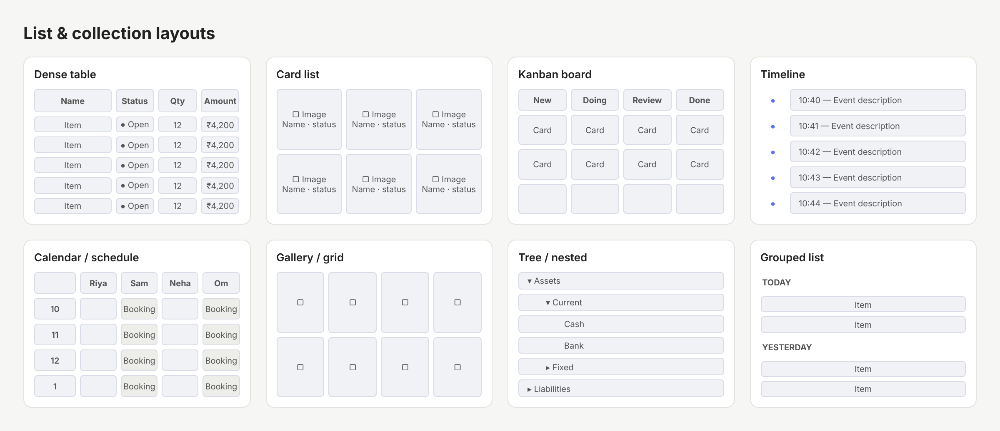

Plus navigation (sidebar, top nav, bottom tabs, command palette, tabs, breadcrumbs, stepper), detail pages, 7 form patterns, settings, onboarding, empty states, feedback, search and mobile patterns.

### Component variants

The right variant for the content — e.g. the control depends on how many options there are.

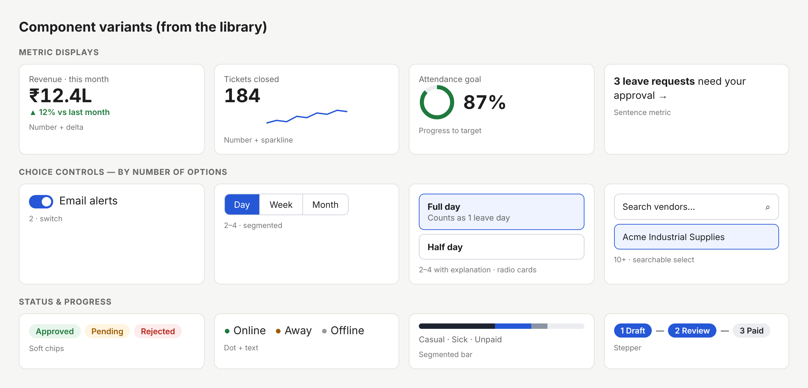

### Domain playbooks & type/colour

- **Domains** — what good looks like for HR, ERP/manufacturing, POS/restaurant, salon/booking, CRM, finance, healthcare, e-commerce, education, logistics, monitoring/IoT, real estate, internal tools and marketing sites.
- **Type & colour** — 13 font pairings by personality, type scales, a full palette built from your brand colour (OKLCH), 8 colour strategies, dark mode, colour-blind-safe chart colours.

<sub>Preview images are generated by `docs/build-previews.py` (screens in `docs/screens.py`) — re-run it after changing the library. The `docs/` folder isn't installed with the skill.</sub>

## Project files it creates

```
your-project/
├── design.md                  # your design system (generated if missing, with your OK)
└── .ui-fix/
    ├── memory.md              # decisions, rejected ideas, glossary, score history — commit this
    ├── harness/               # reusable test harness for pages behind login/API — commit this
    └── runs/<date>-<screen>/  # screenshots, backups, restore.sh, demo.html — add to .gitignore
```

## Get the most out of it

- **Have a `design.md`.** No design.md? Let the first run generate one, then fix the `(inferred)` lines.
- **Keep your dev server runnable** with seed/test data. Real screenshots, walkthroughs and visual regression need it. Without a browser it still works from code — just with less proof.
- **Give it a browser** — Claude in Chrome, a built-in browser pane, or Playwright.
- **Say yes or no to upgrades.** It remembers both, so it never argues the same point twice.
- **Local / dev / staging only.** It clicks choices and fills fields while testing. Never point it at production.

---

## What's inside

```
skills/ui-fix/
├── SKILL.md                              # the pipeline
├── references/
│   ├── anti-slop.md                      # craft checks, AI tells → fixes, uniqueness, how much to change, order of passes
│   ├── harness-and-safety.md             # test harness, restore points, "I don't see changes", rule conflicts
│   ├── dashboards-and-content.md         # dashboard check, text density, clipped content
│   ├── visual-design.md                  # type, colour roles, surfaces, components, polish, design directions
│   ├── layout-and-spacing.md             # grid, alignment, balance, widths, spacing, placement, blueprint
│   ├── understand-the-screen.md          # purpose, data flow, element inventory, Screen brief
│   ├── walkthrough-and-stress.md         # personas, friction log, stress tests, consistency
│   ├── hierarchy-and-naming.md           # headings vs labels, confusing names, placeholders
│   ├── dependencies-and-navigation.md    # parent→child fields, section index, numbering, icons
│   ├── forms-and-data-entry.md           # effort, controls, dropdowns, validation
│   ├── prove-and-remember.md             # impact ranking, proof, regression guard, memory, hand-off
│   ├── design-md-template.md             # starter design.md
│   └── library/
│       ├── befui.md                      # befui: when, exact CLI/MCP, job→component map, restyling via tokens
│       ├── styles.md                     # 12 complete visual styles + slop traps + blending
│       ├── patterns.md                   # layouts per screen type
│       ├── components.md                 # component variants
│       ├── domains.md                    # what good looks like per domain
│       └── type-and-colour.md            # font pairings, palettes, dark mode, chart colours
└── scripts/
    ├── slop-scan.js                      # off-grid spacing, sibling mismatches, centring, gradients/glows/emoji, hype copy, motion (browser)
    ├── text-density.js                   # words per section/screen, tiny text, repeated numbers (browser)
    ├── clip-scan.js                      # text hidden by fixed heights / overflow / ellipsis (browser)
    ├── style-inventory.js                # counts fonts, sizes, colours, radii, shadows, button styles; contrast (browser)
    ├── layout-scan.js                    # grid, balance, dead zones, widths, spacing rhythm, layout map (browser)
    ├── axe-run.js                        # accessibility + tap targets + overflow (browser)
    ├── hierarchy-scan.js                 # heading/label styles, spacing, naming problems (browser)
    ├── dependency-scan.js                # maps dependent fields by flipping choices (browser, dev only)
    ├── focus-scan.js                     # tab order, focus visibility, unreachable clickables (browser)
    ├── stress-text.js                    # pseudo-localization, other scripts, RTL, long values (browser, reversible)
    └── token-scan.mjs                    # hardcoded colours/sizes/inline styles (Node)
```

Run the token scan on its own:
```bash
node ~/.claude/skills/ui-fix/scripts/token-scan.mjs src/pages
```

---

The "audit the common signs of generated UI, fix in layered passes, leave good screens alone" idea is in the spirit of [unslop](https://heydamir.design/unslop) by Damir Sokolovsky (CC BY 4.0). The checks, scan and rules here are written for ui-fix.

MIT · Made by [Aditya Badgujar](https://adityabadgujar.dev) at [BeForth](https://beforth.in)
